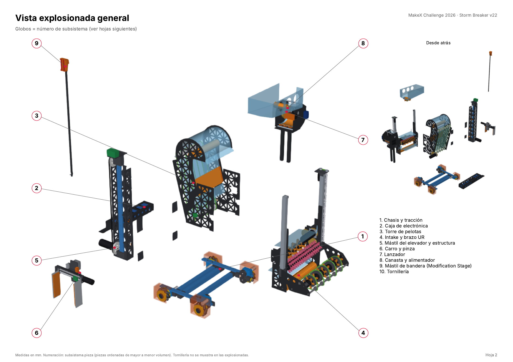

# 2026 MakeX Challenge — Storm Breaker (Robótica 76)

Collaborative engineering repository of team **Robótica 76** for the 2026 MakeX Challenge
**Storm Breaker**: robot design (CAD v22), robot programs, a field simulator, strategy studies,
and the documentation that ties them together.

> **Status (2026-11-06):** the robot exists in CAD (revision v22, 211 numbered parts) and its
> programs run in the team's simulator. **Nothing has been built or tested on a real robot yet.**
> Every number below is a CAD check or a simulation result.



## The robot in one page

| Function | How (v22) | Key decision |
| --- | --- | --- |
| Drive | 4 × 80 mm mecanum on 180 encoder motors; encoder + gyro odometry, closed-loop moves | DEC-M01, DEC-S01 |
| Collect balls | Wide intake (floor and both Central Resource Area shelves) with a lifting UR head | DEC-M08 |
| Store | Tower 3 balls wide (~15) → elbow → basket (6–8) | DEC-M03, DEC-M04 |
| Shoot | Fixed inverted friction-wheel launcher on the left, fed by a short roller that doubles as the gate; aim assist from odometry | DEC-M02, DEC-M05, DEC-S06 |
| Props | Lead-screw gripper on a 358 mm belt elevator (right side); intake head pulls cubes off | — |
| Flag | Removable C-head mast added in the Modification Stage | DEC-M12 |
| Electronics | NovaPi + power board + LiPo 3S 4200 mAh in a structural CF box | DEC-M10 |

Envelope 499.5 × 499.0 × 642 mm · mass 9.88 kg (limit 10 kg) · motors 13/13, brushless 2/2, servo 1/6.

## Repository organisation

| Area | What is there | Start with |
| --- | --- | --- |
| [mechanical](mechanical/README.md) | One folder per subsystem (`chassis`, `ball_intake`, `feeder` = tower, `ball_storage` = basket, `shooter`, `gripper`, `gripper_elevation`, `flag_system`, `common_parts`), each with `cad/` (numbered STL), `drawings/`, `manufacturing/` (BOM + process), `prototypes/` (test plan); whole robot in `assemblies/full_robot/v22` | [v22 README](mechanical/assemblies/full_robot/v22/README.md), [assembly manual PDF](mechanical/assemblies/full_robot/v22/docs/Ensamble_StormBreaker_v22.pdf) |
| [software](software/README.md) | Robot programs for the NovaPi (mBlock Python): competition program, drive control, automatic routines | [`storm_breaker_2026.py`](software/robot/main/README.md) |
| [simulation](simulation/README.md) | 2D / 3D field simulator that runs the robot programs, Monte Carlo and strategy analyses | [field2d](simulation/field2d/README.md) |
| [docs](docs/README.md) | Requirements, architecture, design, controls, integration, verification, strategy, engineering notebook | [decision register](docs/08_engineering_notebook/design_log/DL-SYS-001_design_decisions.md) |
| [electrical](electrical/README.md) | Controller, motor allocation, power, sensors, BOM | [architecture](electrical/architecture/README.md) |
| [tests](tests/README.md) | Test levels, automated simulator tests, reports (none physical yet) | — |
| [tools](tools/README.md) | Bundler and block converter for mBlock, STEP → GLB, mass estimate, calibration procedures | [scripts](tools/scripts/README.md) |
| [resources](resources/README.md) | Rules Guide V1.1, kit tutorial, element data | [rules](resources/rules/README.md) |
| [.github](.github/COLLABORATION.md) | Issue forms and PR template | [CONTRIBUTING.md](CONTRIBUTING.md) |

## Code

| Code | Language / runtime | Entry point |
| --- | --- | --- |
| Robot programs | Python subset of mBlock (NovaPi); blocks ↔ Python with `python_to_mblock.py` / `mblock_project.py` | `software/robot/main/storm_breaker_2026.py` |
| Simulator | Python 3.8+, pygame (2D), Panda3D + trimesh (3D) | `simulation/field2d/viewer.py`, `simulation/field3d/viewer3d.py` |
| Analyses | Python, multiprocessing, matplotlib | `simulation/analysis/*.py` |
| CAD | CadQuery / Open CASCADE (scripts in `mechanical/assemblies/full_robot/v22/source`, not runnable from the repo as is) | `robot_v22.py` |

```bash
python3 -m venv .venv && .venv/bin/pip install -r simulation/field2d/requirements.txt
cd simulation/field2d && ../../.venv/bin/python viewer.py      # 2D simulator
../../.venv/bin/python -m unittest                              # simulator tests
```

## Mechanics

Design history v15 → v22 and every decision with its rejected alternatives:
[full_robot](mechanical/assemblies/full_robot/README.md), [DL-SYS-001](docs/08_engineering_notebook/design_log/DL-SYS-001_design_decisions.md).
Part numbers `<subsystem>.<part>` are the same in the manual, the STL names and the BOMs.

## Control

- **Drive:** `chassis.py` — odometry (encoders for distance, gyro for heading), closed-loop `drive` /
  `turn_to`, adaptive S-curve for the driver, robot "fronts" as angles; the competition program adds
  profiled point-to-point motion in field coordinates. [Drivetrain motion control](docs/04_controls/drivetrain_motion_control.md).
- **Match:** wait for N1 → automatic missions in `ORDER` (X12 bonus cube first) → manual loop with
  ball / gripper modes, aim assist (R2 fortress, N3 X mark), N4 flag. [Stateflow](docs/04_controls/stateflow/README.md),
  [manual bindings](docs/04_controls/manual_control/README.md).
- **Strategy:** chosen by Monte Carlo over sampled robots and reinforcement learning on a 2 vs 2 game.
  [Strategy](docs/07_strategy/README.md).

## Proposed tests

No physical test has been run. Proposed campaign, in order
([details](docs/06_verification/README.md#proposed-test-campaign-from-the-cad-and-simulation-predictions)):

1. Weigh parts and the robot (CAD 9.88 kg) and locate the CG.
2. Wire and check the port map; confirm the NovaPi sensor API names.
3. Calibrate the drive (wheel travel, strafe slip, gyro scale / drift) — the Monte Carlo shows
   calibration is what makes 1 cm / 1.5° per move achievable.
4. T05-R8 (3 m, < 5 cm drift) and T05-R9 (90°, < 5° error).
5. Stability: static tip angle (≥ 26°), braking at 0.35 g.
6. Ball path one subsystem at a time, then 20 balls end to end; launcher range table at 1, 2, 3 m.
7. Gripper, elevator and flag mast on a real flag bar (after deciding KI-008).
8. Automatic stage with the start jig (target P(X12) ≈ 0.96), then full-match rehearsals.

## Open issues

KI-001 footprint margin 0.5 mm · KI-002 no motor in reserve · KI-003 power module hidden by the CF
lid · KI-004 no team ID plate · KI-008 flag mast position vs the simulated approach · KI-009
elevator travel 358 vs 430 mm · KI-010 nine DC motors for eight DC ports —
[known issues](docs/05_integration/known_issues.md).

## Working together

Read [CONTRIBUTING.md](CONTRIBUTING.md): one issue per change with acceptance criteria, branch
`feature/<issue>-<description>`, pull request with review. Record decisions and evidence in the
[engineering notebook](docs/08_engineering_notebook/README.md) while working. License: [MIT](LICENSE).
