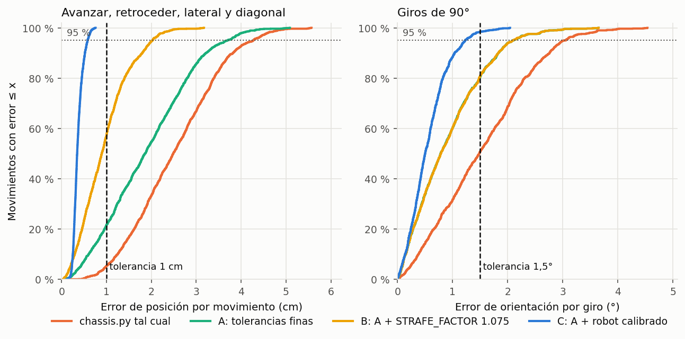
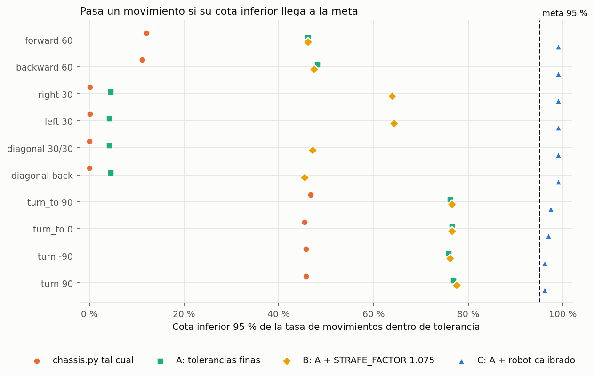
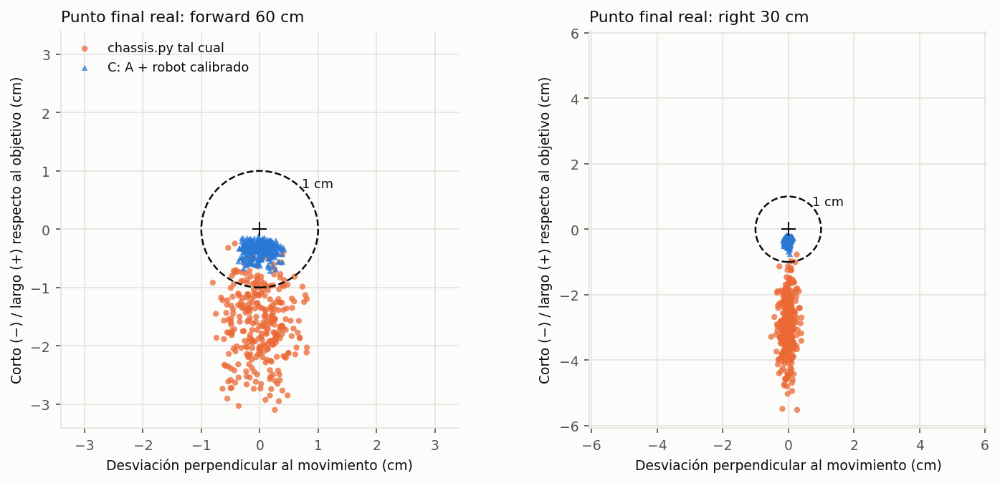
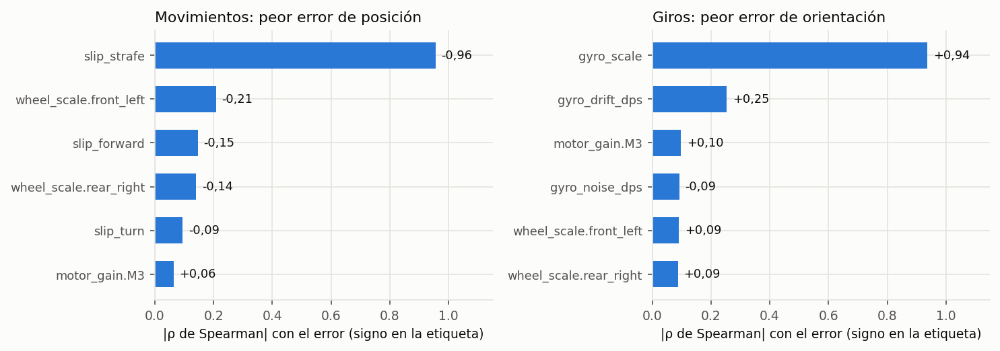
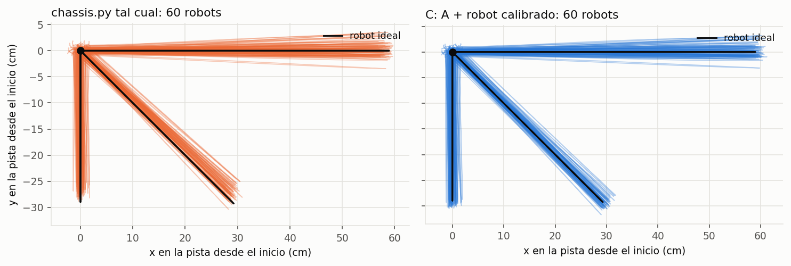
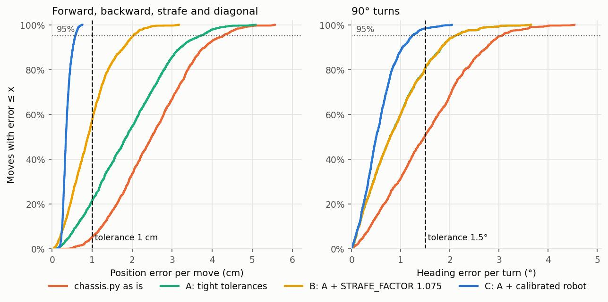
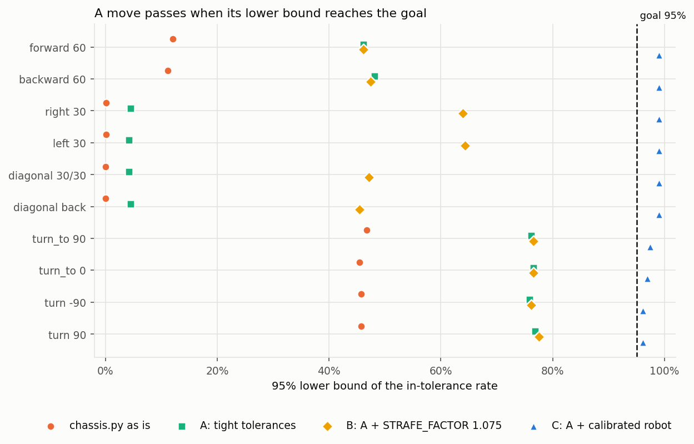
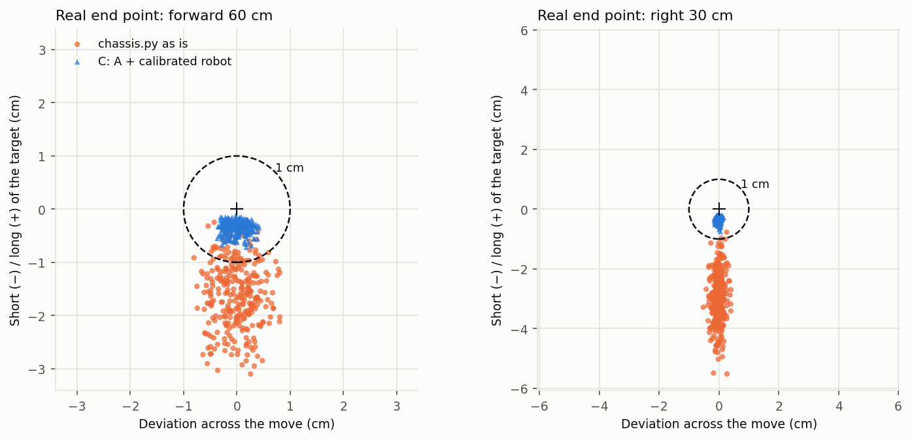
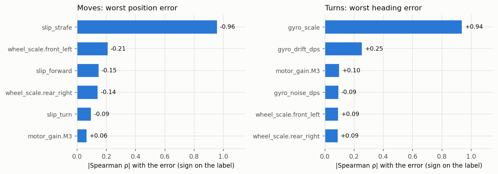
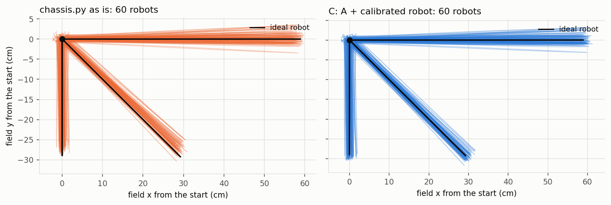

# Monte Carlo: chassis.py

**[Español](#español)** · **[English](#english)**

## Español

Estudio de `software/controls/drivetrain/chassis.py` en el simulador 2D
(`simulation/field2d`) con 300 robots simulados por escenario, cada uno con
errores distintos de ruedas, motores, deslizamiento, giroscopio y encoders.
Generado el 2026-10-23 por `simulation/analysis/make_chassis_report.py`
(semilla 2026, 3 min). Volver a correrlo reproduce estos números.

### Resumen

**Requisito:** error ≤ 1 cm por movimiento en más del
95 % de los movimientos, con 95 % de confianza.
Para los giros, que no tenían requisito, se usa 1,5°, la tolerancia
actual de `chassis.py`.

| Escenario | Movimientos que pasan | Peor p95 avance/lateral | Peor p95 giro | Rutina completa (media) |
| --- | --- | --- | --- | --- |
| chassis.py tal cual | 0/10 | 4,46 cm | 3,06° | 25,7 s |
| A: tolerancias finas | 0/10 | 3,87 cm | 2,15° | 27,1 s |
| B: A + STRAFE_FACTOR 1.075 | 0/10 | 2,09 cm | 2,16° | 27,2 s |
| C: A + robot calibrado | 10/10 | 0,63 cm | 1,27° | 26,8 s |
| D: C sin GYRO_SCALE | 6/10 | 0,63 cm | 2,14° | 26,8 s |

1. **`chassis.py` tal cual no cumple** en ninguno de los 10 tipos de movimiento.
2. **Las tolerancias están en el límite del requisito.** `drive()` se detiene en cuanto
   está a menos de `TOL_CM = 1.0` cm, así que un robot ideal ya termina
   0,95–1,00 cm antes del objetivo.
3. **El resto del error no lo ven los encoders.** En al menos el 99,7 % de los
   casos la odometría dice "llegué", pero el robot real está en otro lugar. El
   deslizamiento lateral explica casi todo el error al moverse (ρ = -0,96) y
   el error de escala del giroscopio el de los giros (ρ = +0,94).
4. **Con tolerancias finas y el robot calibrado sí cumple** (escenario C): todos los
   movimientos pasan, con peor error de 0,76 cm y cotas inferiores de
   99,0 % (movimientos) y 96,1 % (giros).
5. **La escala del giroscopio hay que corregirla en el código.** Sin `GYRO_SCALE`
   (escenario D) pasan 0 de 4 giros. `chassis.py` todavía no tiene esa constante.
6. **Costo en tiempo:** la rutina pasa de 25,7 s a 26,8 s de
   media con las tolerancias finas.

Los rangos de error son **estimaciones**, no mediciones del robot. El estudio prueba la
lógica de control contra esas suposiciones; la calibración de abajo convierte las
suposiciones en datos.

### Parámetros a escribir en `chassis.py`

| Constante | Hoy | Escribir | Origen |
| --- | --- | --- | --- |
| `TOL_CM` | 1.0 | **0.3** | Este estudio (escenarios A–C) |
| `TOL_DEGREES` | 1.5 | **0.5** | Este estudio |
| `GYRO_SIGN` | 1 | 1 o −1 | Paso 1 |
| `WHEEL_DIAMETER` | 8.0 | diámetro **efectivo** medido | Paso 3 (`DEGREES_PER_CM` se recalcula solo) |
| `STRAFE_FACTOR` | 1.0 | medido (se estima ≈ 1,05–1,10) | Paso 4 |
| `GYRO_SCALE` | no existe | medido (≈ 1,00) | Paso 5; **requiere el cambio de código siguiente** |

Cambio propuesto en `chassis.py` (dos líneas, no aplicado todavía):

```python
GYRO_SCALE = 1.0   # real degrees / gyro degrees, from the 10-turn test (calibration step 5)

# in Odometry.update():
w = (read_gyro_z() - self.gyro_bias) * GYRO_SIGN * GYRO_SCALE
```

Precisión que tiene que lograr la calibración (la que se simuló en el escenario C, 1σ):

| Magnitud | Precisión | En la prueba |
| --- | --- | --- |
| Diámetro efectivo de rueda | 0,2 % | ±4 mm en 2 m |
| Deslizamiento al avanzar | 0,3 % | incluido en el diámetro efectivo |
| Deslizamiento lateral | 0,5 % | ±5 mm en 1 m |
| Escala del giroscopio | 0,2 % | ±7° en 10 vueltas |

### Pasos de calibración

Hacerlos **en el tapete de competencia** (el deslizamiento cambia con la superficie),
con la batería cargada, el robot con su peso final y las ruedas limpias. Material:
cinta métrica en mm, cinta adhesiva para marcas y un programa que imprima `odo.x`,
`odo.y` y `odo.heading` (por ejemplo `simulation/control/test_chassis_control_manual.py`).
Cada medición se repite **3 veces en cada sentido** y se usa el promedio.

1. **Signo del giroscopio.** Con el programa corriendo, girar el robot a mano 90° en
   sentido horario. Si `odo.heading` aumenta, `GYRO_SIGN = 1`; si disminuye,
   `GYRO_SIGN = -1`.
2. **Deriva en reposo.** Tras `odo.calibrate()`, dejar el robot quieto 60 s. Si
   `odo.heading` cambia más de 1°, alargar la calibración (`odo.calibrate(2.0)`) y
   repetirla justo antes de cada ronda.
3. **Diámetro efectivo de rueda** (corrige diámetro y deslizamiento al avanzar).
   Desde una marca, ejecutar `drive(forward_cm=200, timeout=10)` (el `timeout` por
   defecto de 5 s no alcanza para 2 m a `AUTO_SPEED`). Medir la distancia real `D_real`
   en cm y anotar la de la odometría `D_odo` (≈ 200).
   `WHEEL_DIAMETER = WHEEL_DIAMETER_actual × D_real / D_odo`. Repetir hacia atrás.
4. **Factor lateral** (después del paso 3). Ejecutar `drive(right_cm=100, timeout=10)`,
   medir el desplazamiento lateral real `D_real` y la odometría `D_odo` (≈ 100).
   `STRAFE_FACTOR = STRAFE_FACTOR_actual × D_odo / D_real`. Repetir hacia la izquierda.
5. **Escala del giroscopio** (requiere el cambio de código de arriba). Alinear un borde
   del robot con una línea de cinta, anotar `odo.heading`, girar el robot a mano
   **10 vueltas completas** hasta volver a alinearlo y anotar el cambio total `H` de
   `odo.heading` (no se normaliza, así que puede pasar de 360).
   `GYRO_SCALE = GYRO_SCALE_actual × 3600 / |H|`. Repetir en el otro sentido.
6. **Tolerancias.** Escribir `TOL_CM = 0.3` y `TOL_DEGREES = 0.5`. Revisar que los
   `timeout` de las rutinas sigan alcanzando (cada movimiento tarda algo más, ver la
   tabla del escenario C).
7. **Verificación en la pista.** Correr la rutina del estudio (avanzar/retroceder 60 cm,
   lateral 30 cm, diagonales, giros de 90°) al menos 10 veces y medir cada movimiento.
   Todos deben quedar dentro de 1 cm. Demostrar 95 % con 95 % de confianza **solo con
   pruebas físicas** pide 59 repeticiones sin fallas por tipo de movimiento; por
   eso la parte estadística la cubre la simulación, y las pruebas físicas sirven para
   comprobar que el robot se comporta como el modelo.
8. **Actualizar el modelo.** Pasar las dispersiones medidas a
   `simulation/analysis/montecarlo_config_calibrated.json` y volver a generar este
   reporte.

### Figuras



**Distribución acumulada del error.** Cada curva indica qué fracción de los movimientos
quedó por debajo de cada error. Para cumplir, la curva tiene que cruzar la línea de
95 % a la izquierda de la tolerancia. Solo el escenario C lo logra en los dos paneles.



**Cota inferior de 95 % por movimiento.** Es el valor que se compara con la meta. Con
300 robots, la cota queda algo por debajo de la tasa observada.



**Dónde termina realmente el robot.** Cada punto es un robot. Tal cual, los robots
terminan cortos (por debajo de 0) y desviados al ir de lado. Calibrados, quedan dentro
del círculo de 1 cm.



**Qué parámetro causa el error** (escenario tal cual). Una barra larga indica que ese
parámetro ordena casi por completo a los robots del peor al mejor.



**Trayectorias reales de 60 robots** (la línea negra es el robot
ideal). La dispersión es de pocos centímetros, por eso la escala va en cm desde el
punto de inicio.

### Detalle por movimiento

#### chassis.py tal cual

| Movimiento | Tolerancia | Dentro / total | Cota inf. 95 % | Resultado | Error medio | p95 | Máx. | Tiempo medio |
| --- | --- | --- | --- | --- | --- | --- | --- | --- |
| forward 60 | 1 cm | 46/300 | 12,0 % | **FALLA** | 1,66 | 2,67 | 3,11 | 2,7 s |
| backward 60 | 1 cm | 43/300 | 11,1 % | **FALLA** | 1,66 | 2,69 | 3,13 | 2,7 s |
| right 30 | 1 cm | 2/300 | 0,1 % | **FALLA** | 2,98 | 4,46 | 5,53 | 1,8 s |
| left 30 | 1 cm | 2/300 | 0,1 % | **FALLA** | 2,99 | 4,45 | 5,53 | 1,8 s |
| diagonal 30/30 | 1 cm | 1/300 | 0,0 % | **FALLA** | 2,93 | 4,41 | 5,47 | 2,3 s |
| diagonal back | 1 cm | 1/300 | 0,0 % | **FALLA** | 2,93 | 4,36 | 5,57 | 2,3 s |
| turn_to 90 | 1,5° | 155/300 | 46,8 % | **FALLA** | 1,51 | 2,94 | 4,49 | 2,7 s |
| turn_to 0 | 1,5° | 151/300 | 45,4 % | **FALLA** | 1,56 | 3,06 | 4,27 | 2,7 s |
| turn -90 | 1,5° | 152/300 | 45,8 % | **FALLA** | 1,53 | 3,06 | 4,54 | 2,7 s |
| turn 90 | 1,5° | 152/300 | 45,8 % | **FALLA** | 1,53 | 3,06 | 4,46 | 2,8 s |

#### C: tolerancias finas y robot calibrado

| Movimiento | Tolerancia | Dentro / total | Cota inf. 95 % | Resultado | Error medio | p95 | Máx. | Tiempo medio |
| --- | --- | --- | --- | --- | --- | --- | --- | --- |
| forward 60 | 1 cm | 300/300 | 99,0 % | **PASA** | 0,39 | 0,62 | 0,74 | 2,9 s |
| backward 60 | 1 cm | 300/300 | 99,0 % | **PASA** | 0,40 | 0,63 | 0,72 | 2,9 s |
| right 30 | 1 cm | 300/300 | 99,0 % | **PASA** | 0,34 | 0,54 | 0,76 | 2,0 s |
| left 30 | 1 cm | 300/300 | 99,0 % | **PASA** | 0,34 | 0,54 | 0,71 | 2,0 s |
| diagonal 30/30 | 1 cm | 300/300 | 99,0 % | **PASA** | 0,37 | 0,56 | 0,71 | 2,4 s |
| diagonal back | 1 cm | 300/300 | 99,0 % | **PASA** | 0,37 | 0,55 | 0,70 | 2,4 s |
| turn_to 90 | 1,5° | 297/300 | 97,4 % | **PASA** | 0,54 | 1,16 | 1,60 | 2,8 s |
| turn_to 0 | 1,5° | 296/300 | 97,0 % | **PASA** | 0,57 | 1,27 | 2,02 | 2,8 s |
| turn -90 | 1,5° | 294/300 | 96,1 % | **PASA** | 0,54 | 1,23 | 2,04 | 2,8 s |
| turn 90 | 1,5° | 294/300 | 96,1 % | **PASA** | 0,59 | 1,22 | 1,91 | 2,8 s |

#### D: como C, sin corregir la escala del giroscopio

| Movimiento | Tolerancia | Dentro / total | Cota inf. 95 % | Resultado | Error medio | p95 | Máx. | Tiempo medio |
| --- | --- | --- | --- | --- | --- | --- | --- | --- |
| forward 60 | 1 cm | 300/300 | 99,0 % | **PASA** | 0,39 | 0,61 | 0,74 | 2,9 s |
| backward 60 | 1 cm | 300/300 | 99,0 % | **PASA** | 0,40 | 0,63 | 0,72 | 2,9 s |
| right 30 | 1 cm | 300/300 | 99,0 % | **PASA** | 0,34 | 0,54 | 0,76 | 2,0 s |
| left 30 | 1 cm | 300/300 | 99,0 % | **PASA** | 0,34 | 0,54 | 0,71 | 2,0 s |
| diagonal 30/30 | 1 cm | 300/300 | 99,0 % | **PASA** | 0,37 | 0,56 | 0,70 | 2,4 s |
| diagonal back | 1 cm | 300/300 | 99,0 % | **PASA** | 0,37 | 0,55 | 0,70 | 2,4 s |
| turn_to 90 | 1,5° | 244/300 | 77,2 % | **FALLA** | 0,89 | 1,95 | 3,59 | 2,8 s |
| turn_to 0 | 1,5° | 240/300 | 75,8 % | **FALLA** | 0,93 | 2,13 | 3,47 | 2,8 s |
| turn -90 | 1,5° | 239/300 | 75,5 % | **FALLA** | 0,91 | 2,14 | 3,59 | 2,8 s |
| turn 90 | 1,5° | 242/300 | 76,5 % | **FALLA** | 0,92 | 2,07 | 3,43 | 2,8 s |

### Método

- **Rutina:** `simulation/analysis/mc_routine_chassis.py` ejecuta 10 movimientos de
  `chassis.py` y marca la posición *real* del simulador antes y después de cada uno
  (`simtrace.mark`, solo existe en el simulador).
- **Error medido:** desplazamiento real contra el ordenado, en el marco del robot al
  inicio del movimiento (cm), y para los giros, el cambio real de orientación contra
  el ordenado (°).
- **Robots simulados:** cada uno se muestrea con `uncertainty.Variation` a partir de
  los rangos de `montecarlo_config.json` (sin calibrar) o
  `montecarlo_config_calibrated.json` (error residual después de calibrar). Los
  escenarios A–D además cambian constantes de `chassis.py` solo durante la simulación,
  sin modificar el archivo.
- **Criterio estadístico:** cota inferior unilateral exacta de Clopper-Pearson al
  95 % sobre la tasa de movimientos dentro de tolerancia, que tiene
  que llegar al 95 %. Cada robot es independiente, así que cada
  tipo de movimiento tiene n = 300. Sin fallas, el mínimo es 59 robots.
- **Sensibilidad:** correlación de rangos de Spearman entre cada parámetro muestreado
  y el peor error del robot.

### Límites

- Los rangos son estimaciones hasta tener mediciones.
- El modelo no tiene choques ni contacto con estructuras de la pista, caída de voltaje
  de la batería, ni variaciones de geometría del chasis.
- Los motores tienen solo un retardo de primer orden.

Por todo esto, el estudio no prueba que el robot real cumpla: muestra qué hace falta
para que la lógica de `chassis.py` pueda cumplir.

---

## English

Study of `software/controls/drivetrain/chassis.py` in the 2D simulator
(`simulation/field2d`) with 300 simulated robots per scenario, each with its own
wheel, motor, slip, gyroscope and encoder errors. Generated on 2026-10-23
by `simulation/analysis/make_chassis_report.py` (seed 2026, 3 min).
Running it again reproduces these numbers.

### Summary

**Requirement:** error ≤ 1 cm per move in more than
95% of moves, with 95% confidence. Turns had
no requirement, so they use 1.5°, the current tolerance in `chassis.py`.

| Scenario | Moves that pass | Worst p95 drive/strafe | Worst p95 turn | Full routine (mean) |
| --- | --- | --- | --- | --- |
| chassis.py as is | 0/10 | 4.46 cm | 3.06° | 25.7 s |
| A: tight tolerances | 0/10 | 3.87 cm | 2.15° | 27.1 s |
| B: A + STRAFE_FACTOR 1.075 | 0/10 | 2.09 cm | 2.16° | 27.2 s |
| C: A + calibrated robot | 10/10 | 0.63 cm | 1.27° | 26.8 s |
| D: C without GYRO_SCALE | 6/10 | 0.63 cm | 2.14° | 26.8 s |

1. **`chassis.py` as is does not meet it** for any of the 10 move types.
2. **The tolerances sit on the requirement.** `drive()` stops as soon as it is within
   `TOL_CM = 1.0` cm, so even an ideal robot ends 0.95–1.00 cm
   short of the target.
3. **The remaining error is invisible to the encoders.** In at least 99.7% of
   the cases odometry says "arrived" while the real robot is elsewhere. Strafe slip
   explains almost all of the drive error (ρ = -0.96) and gyro scale error
   the turn error (ρ = +0.94).
4. **With tight tolerances and a calibrated robot it passes** (scenario C): every move
   passes, worst error 0.76 cm, lower bounds 99.0% (moves)
   and 96.1% (turns).
5. **The gyro scale has to be corrected in code.** Without `GYRO_SCALE` (scenario D),
   0 of 4 turns pass. `chassis.py` does not have that constant yet.
6. **Time cost:** the routine goes from 25.7 s to 26.8 s on
   average with the tight tolerances.

The error ranges are **estimates**, not robot measurements. The study tests the control
logic against those assumptions; the calibration below turns the assumptions into data.

### Parameters to write in `chassis.py`

| Constant | Today | Write | Source |
| --- | --- | --- | --- |
| `TOL_CM` | 1.0 | **0.3** | This study (scenarios A–C) |
| `TOL_DEGREES` | 1.5 | **0.5** | This study |
| `GYRO_SIGN` | 1 | 1 or −1 | Step 1 |
| `WHEEL_DIAMETER` | 8.0 | measured **effective** diameter | Step 3 (`DEGREES_PER_CM` follows) |
| `STRAFE_FACTOR` | 1.0 | measured (estimated ≈ 1.05–1.10) | Step 4 |
| `GYRO_SCALE` | does not exist | measured (≈ 1.00) | Step 5; **needs the code change below** |

Proposed change in `chassis.py` (two lines, not applied yet):

```python
GYRO_SCALE = 1.0   # real degrees / gyro degrees, from the 10-turn test (calibration step 5)

# in Odometry.update():
w = (read_gyro_z() - self.gyro_bias) * GYRO_SIGN * GYRO_SCALE
```

Accuracy the calibration has to reach (what scenario C simulated, 1σ):

| Quantity | Accuracy | In the test |
| --- | --- | --- |
| Effective wheel diameter | 0.2% | ±4 mm over 2 m |
| Forward slip | 0.3% | included in the effective diameter |
| Strafe slip | 0.5% | ±5 mm over 1 m |
| Gyroscope scale | 0.2% | ±7° over 10 turns |

### Calibration steps

Do them **on the competition mat** (slip depends on the surface), with a charged
battery, the robot at its final weight and clean wheels. You need a tape measure in mm,
tape for marks and a program that prints `odo.x`, `odo.y` and `odo.heading` (for
example `simulation/control/test_chassis_control_manual.py`). Repeat each measurement
**3 times in each direction** and use the average.

1. **Gyro sign.** With the program running, turn the robot by hand 90° clockwise. If
   `odo.heading` increases, `GYRO_SIGN = 1`; if it decreases, `GYRO_SIGN = -1`.
2. **Drift at rest.** After `odo.calibrate()`, leave the robot still for 60 s. If
   `odo.heading` changes by more than 1°, calibrate longer (`odo.calibrate(2.0)`) and
   repeat it right before each round.
3. **Effective wheel diameter** (corrects diameter and forward slip). From a mark, run
   `drive(forward_cm=200, timeout=10)` (the default 5 s `timeout` is too short for 2 m
   at `AUTO_SPEED`). Measure the real distance `D_real` in cm and note the odometry
   distance `D_odo` (≈ 200).
   `WHEEL_DIAMETER = current WHEEL_DIAMETER × D_real / D_odo`. Repeat backward.
4. **Strafe factor** (after step 3). Run `drive(right_cm=100, timeout=10)`, measure the
   real sideways distance `D_real` and the odometry `D_odo` (≈ 100).
   `STRAFE_FACTOR = current STRAFE_FACTOR × D_odo / D_real`. Repeat to the left.
5. **Gyro scale** (needs the code change above). Line up one edge of the robot with a
   tape line, note `odo.heading`, turn the robot by hand **10 full turns** until it lines
   up again and note the total change `H` of `odo.heading` (it is not wrapped, so it can
   go past 360). `GYRO_SCALE = current GYRO_SCALE × 3600 / |H|`. Repeat the other way.
6. **Tolerances.** Write `TOL_CM = 0.3` and `TOL_DEGREES = 0.5`. Check that the
   routines' `timeout` values are still long enough (each move takes slightly longer,
   see the scenario C table).
7. **Check on the field.** Run the study routine (forward/backward 60 cm, strafe 30 cm,
   diagonals, 90° turns) at least 10 times and measure every move. All must be within
   1 cm. Showing 95% with 95% confidence **from physical tests alone** takes
   59 failure-free repetitions per move type; that is why the simulation covers
   the statistics, and the physical tests check that the robot behaves like the model.
8. **Update the model.** Put the measured spreads into
   `simulation/analysis/montecarlo_config_calibrated.json` and regenerate this report.

### Figures



**Cumulative error distribution.** Each curve shows the fraction of moves below each
error. To pass, a curve has to cross the 95% line to the left of the tolerance. Only
scenario C does, in both panels.



**95% lower bound per move.** This is the value compared with the goal. With
300 robots, the bound sits slightly below the observed rate.



**Where the robot really ends.** Each dot is a robot. As is, robots end short (below 0)
and drift sideways when strafing. Calibrated, they stay inside the 1 cm circle.



**Which parameter causes the error** (scenario as is). A long bar means that parameter
almost fully orders the robots from worst to best.



**Real trajectories of 60 robots** (the black line is the ideal
robot). The spread is a few centimetres, so the axes are in cm from the start point.

### Per-move detail

#### chassis.py as is

| Move | Tolerance | In tolerance / total | 95% lower bound | Result | Mean error | p95 | Max | Mean time |
| --- | --- | --- | --- | --- | --- | --- | --- | --- |
| forward 60 | 1 cm | 46/300 | 12.0% | **FAIL** | 1.66 | 2.67 | 3.11 | 2.7 s |
| backward 60 | 1 cm | 43/300 | 11.1% | **FAIL** | 1.66 | 2.69 | 3.13 | 2.7 s |
| right 30 | 1 cm | 2/300 | 0.1% | **FAIL** | 2.98 | 4.46 | 5.53 | 1.8 s |
| left 30 | 1 cm | 2/300 | 0.1% | **FAIL** | 2.99 | 4.45 | 5.53 | 1.8 s |
| diagonal 30/30 | 1 cm | 1/300 | 0.0% | **FAIL** | 2.93 | 4.41 | 5.47 | 2.3 s |
| diagonal back | 1 cm | 1/300 | 0.0% | **FAIL** | 2.93 | 4.36 | 5.57 | 2.3 s |
| turn_to 90 | 1.5° | 155/300 | 46.8% | **FAIL** | 1.51 | 2.94 | 4.49 | 2.7 s |
| turn_to 0 | 1.5° | 151/300 | 45.4% | **FAIL** | 1.56 | 3.06 | 4.27 | 2.7 s |
| turn -90 | 1.5° | 152/300 | 45.8% | **FAIL** | 1.53 | 3.06 | 4.54 | 2.7 s |
| turn 90 | 1.5° | 152/300 | 45.8% | **FAIL** | 1.53 | 3.06 | 4.46 | 2.8 s |

#### C: tight tolerances and calibrated robot

| Move | Tolerance | In tolerance / total | 95% lower bound | Result | Mean error | p95 | Max | Mean time |
| --- | --- | --- | --- | --- | --- | --- | --- | --- |
| forward 60 | 1 cm | 300/300 | 99.0% | **PASS** | 0.39 | 0.62 | 0.74 | 2.9 s |
| backward 60 | 1 cm | 300/300 | 99.0% | **PASS** | 0.40 | 0.63 | 0.72 | 2.9 s |
| right 30 | 1 cm | 300/300 | 99.0% | **PASS** | 0.34 | 0.54 | 0.76 | 2.0 s |
| left 30 | 1 cm | 300/300 | 99.0% | **PASS** | 0.34 | 0.54 | 0.71 | 2.0 s |
| diagonal 30/30 | 1 cm | 300/300 | 99.0% | **PASS** | 0.37 | 0.56 | 0.71 | 2.4 s |
| diagonal back | 1 cm | 300/300 | 99.0% | **PASS** | 0.37 | 0.55 | 0.70 | 2.4 s |
| turn_to 90 | 1.5° | 297/300 | 97.4% | **PASS** | 0.54 | 1.16 | 1.60 | 2.8 s |
| turn_to 0 | 1.5° | 296/300 | 97.0% | **PASS** | 0.57 | 1.27 | 2.02 | 2.8 s |
| turn -90 | 1.5° | 294/300 | 96.1% | **PASS** | 0.54 | 1.23 | 2.04 | 2.8 s |
| turn 90 | 1.5° | 294/300 | 96.1% | **PASS** | 0.59 | 1.22 | 1.91 | 2.8 s |

#### D: like C, without correcting the gyro scale

| Move | Tolerance | In tolerance / total | 95% lower bound | Result | Mean error | p95 | Max | Mean time |
| --- | --- | --- | --- | --- | --- | --- | --- | --- |
| forward 60 | 1 cm | 300/300 | 99.0% | **PASS** | 0.39 | 0.61 | 0.74 | 2.9 s |
| backward 60 | 1 cm | 300/300 | 99.0% | **PASS** | 0.40 | 0.63 | 0.72 | 2.9 s |
| right 30 | 1 cm | 300/300 | 99.0% | **PASS** | 0.34 | 0.54 | 0.76 | 2.0 s |
| left 30 | 1 cm | 300/300 | 99.0% | **PASS** | 0.34 | 0.54 | 0.71 | 2.0 s |
| diagonal 30/30 | 1 cm | 300/300 | 99.0% | **PASS** | 0.37 | 0.56 | 0.70 | 2.4 s |
| diagonal back | 1 cm | 300/300 | 99.0% | **PASS** | 0.37 | 0.55 | 0.70 | 2.4 s |
| turn_to 90 | 1.5° | 244/300 | 77.2% | **FAIL** | 0.89 | 1.95 | 3.59 | 2.8 s |
| turn_to 0 | 1.5° | 240/300 | 75.8% | **FAIL** | 0.93 | 2.13 | 3.47 | 2.8 s |
| turn -90 | 1.5° | 239/300 | 75.5% | **FAIL** | 0.91 | 2.14 | 3.59 | 2.8 s |
| turn 90 | 1.5° | 242/300 | 76.5% | **FAIL** | 0.92 | 2.07 | 3.43 | 2.8 s |

### Method

- **Routine:** `simulation/analysis/mc_routine_chassis.py` runs 10 `chassis.py` moves and
  marks the simulator's *true* pose before and after each (`simtrace.mark`, simulator
  only).
- **Measured error:** real displacement against the commanded one, in the robot frame at
  the start of the move (cm); for turns, real heading change against the commanded one (°).
- **Simulated robots:** each is sampled with `uncertainty.Variation` from the ranges in
  `montecarlo_config.json` (uncalibrated) or `montecarlo_config_calibrated.json`
  (residual error after calibration). Scenarios A–D also change `chassis.py` constants
  during the simulation only, without editing the file.
- **Statistical criterion:** exact one-sided Clopper-Pearson 95%
  lower bound of the in-tolerance rate, which has to reach 95%.
  Each robot is independent, so each move type has n = 300. With no failures,
  the minimum is 59 robots.
- **Sensitivity:** Spearman rank correlation between each sampled parameter and the
  robot's worst error.

### Limits

- The ranges are estimates until there are measurements.
- The model has no collisions or contact with field structures, no battery voltage
  sag, and no chassis geometry variation.
- Motors have a first-order lag only.

So the study does not prove that the real robot meets the requirement: it shows what is
needed for the `chassis.py` logic to be able to meet it.
