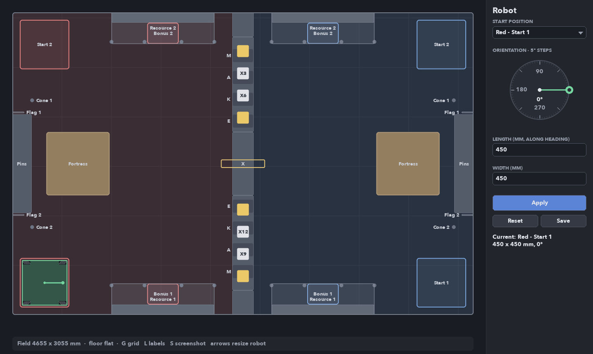

# 2D field layout (Storm Breaker)

2D model of the 2026 MakeX Challenge "Storm Breaker" field for testing autonomous
motion. The robot is a box with a mecanum wheel in each corner and a configurable
footprint; kinematics are not implemented yet.



## Run

```bash
python3 -m venv .venv
.venv/bin/pip install -r simulation/field2d/requirements.txt
cd simulation/field2d
../../.venv/bin/python viewer.py                          # interactive
../../.venv/bin/python viewer.py --length 480 --width 420 --heading 90
../../.venv/bin/python viewer.py --screenshot field.png   # render once, headless
../../.venv/bin/python -m unittest                        # layout sanity checks
```

Keys: `G` grid (500 mm), `L` labels, `S` screenshot, `Esc` quit. Hovering shows the
cursor position in field mm and the elements under it (with their height `z`).

## Robot panel

The panel on the right edits the robot; changes show on the field when you press
**Apply** (or `Enter` in a text box):

- **Start position**: dropdown with Red/Blue Start 1/Start 2. On Apply the robot is
  centred in that start area and its alliance follows the choice. Start 1 is the
  lower area in the viewer (y < 1527 mm), Start 2 the upper one.
- **Orientation**: a clock-style dial. Click or drag on it (or scroll over it) to move
  the green knob around the rim; the value snaps to 5 deg and is shown in the centre.
  0 deg faces the blue side (+x), angles are CCW. Until you apply, a grey hand marks
  the heading currently on the field.
- **Length / Width**: overall footprint in mm, wheels included; length runs along the
  heading. Click a box to type, `Tab` switches boxes, `Esc` leaves them.
- **Reset** reloads `robot_config.json`; **Save** writes the applied values to it.

Invalid values (not a number, above 500 mm per rules T01, or too small for two wheels
per side) are rejected in red. A footprint that sticks out of its 500 x 500 mm start
area at the chosen heading is applied with a warning.

Outside the text boxes, `Up`/`Down` change the length and `Right`/`Left` the width
by 10 mm (`Shift`: 1 mm), applied immediately. `--length`, `--width` and `--heading`
set the starting values from the command line.

Wheels (`wheel_diameter_mm` 80, `wheel_width_mm` 40) sit in the footprint corners;
their top rollers are drawn in the standard "X" layout (front-left/rear-right
parallel, front-right/rear-left parallel).

## Files

| File | Contents |
| --- | --- |
| `field_layout.py` | Field elements (sizes, positions, kinds), red side mirrored to blue |
| `robot_config.json` | Robot footprint, wheel diameter/width, alliance, start area, heading |
| `robot.py` | Config loading/validation/saving (rules T01), mecanum wheel placement, pose |
| `viewer.py` | Pygame renderer (field drawn at 3x and smooth-scaled, cached) and main loop |
| `theme.py` | Soft dark palette, corner radius and fonts (Avenir Next, falls back to Helvetica/Arial) |
| `panel.py`, `ui.py` | Robot side panel (start dropdown, orientation dial, size boxes, Apply) and widgets |
| `test_field_layout.py` | Layout, robot size/wheels and headless panel checks |

## Frame and conventions

- Origin at the red-side field corner (bottom-left of rules Fig 4.2-1); `x` toward
  blue, `y` up, angles CCW, units mm. Field 4655 x 3055 mm.
- Element kinds: `obstacle` (solid on the floor), `movable` (mobile fortress),
  `zone` (start areas, bonus exchange pads), `overhead` (resource shelves, flag
  poles: no floor collision), `no_touch` (X mark, rule R24), `slot` (strategy
  channel windows, MAKE order from the wall end), `prop` (cones, bonus cubes).
- Red movement limit is `x <= 2220 mm`; blue is `x >= 2435 mm` (rules Fig 4.2-3).
  The strip between them is closed by the strategy areas, the central rack and the
  central barrier (rule R02) up to both walls.

## Relief

The floor is flat: a printed map with no ramps, steps or slopes (rules p.55 T04,
"flat field surface"; renders in Fig 4.1 and 4.2-1 show only printed graphics). A
2D kinematic model needs no terrain. Relief comes only from structures; each
element has a top height `z` in mm (shown when hovering in the viewer):

| Element | z (mm) | Notes |
| --- | --- | --- |
| Start areas, bonus exchange pads, channel windows | 0 | Floor markings |
| Pin placement area / cone posts | 405 | rules p.15, p.17 |
| Strategy areas, central barrier | 259 | Channel opening 254 mm (p.18); barrier height estimated |
| Mobile fortress | 646 | Letter level 171 mm, ball basket 407 mm (p.21) |
| Central resource rack / X mark | 654 / 947 | p.21 |
| Own resource area | 965 | Shelf underside ~758 mm (p.13) |
| Flag poles | 961 | p.15 |
| Cones / bonus cubes | 170 / 120 | p.24-25 |

## Sources and accuracy

Element **sizes** come from the 2026 MakeX Challenge Storm Breaker Rules Guide
V1.1 (2026.9), section 4.2-4.3; each element cites the page in its `source` field.
The rules rarely give **positions**, so placements are scaled from the top view
(Fig 4.2-1, ~3.44 mm/px) and marked `estimate`; expect roughly +/-30 mm. Assumptions
to verify against the official building instructions (rules Appendix 9):

- Start areas inset ~75 mm from both walls.
- Resource area centres 807.5 mm from the centre line; the bonus exchange pad is
  under the shelf on the field side, with the remaining 104 mm treated as a wall.
- Mobile fortress centre at x = 662 mm; cone posts at x = 200 mm, 1280 mm apart.
- Strategy areas touch the central rack (640 mm); the ~248 mm gap to each wall is
  modelled as the central barrier.
- Prop positions on the strategy areas follow the drawing; real matches use one of
  10 prop cards (rules p.51, Appendix 8), and the X values shown are placeholders.
