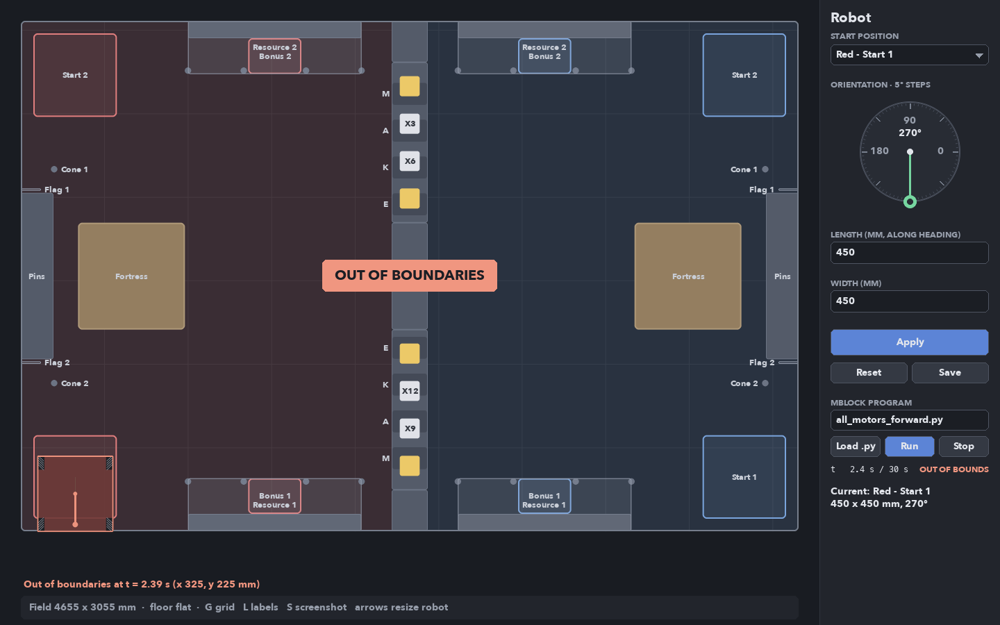
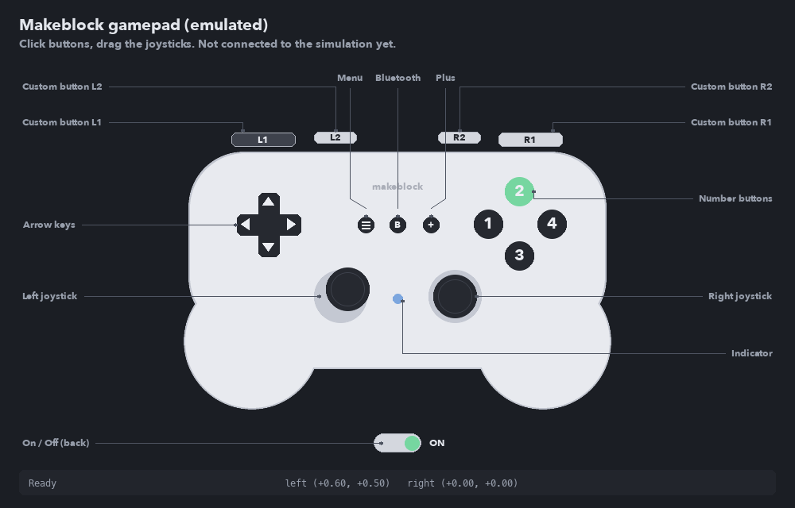

# 2D field layout (Storm Breaker)

2D model of the 2026 MakeX Challenge "Storm Breaker" field for testing autonomous
motion. The robot is a box with a mecanum wheel in each corner and a configurable
footprint. Python programs generated by mBlock (novapi / mbuild) can be loaded and
played back on the field with mecanum kinematics.


## Run

**Windows:** double-click `run_simulator.bat`. The first time it creates `.venv` at
the repository root and installs pygame (needs Python 3.8+ on PATH and internet),
then shows a menu: empty simulator, automatic chassis demo, or manual chassis demo.
Arguments are passed to `viewer.py` (e.g. `run_simulator.bat --time-limit 0`).

**macOS:** double-click `run_simulator.command` (opens Terminal, same first-run
setup with `python3`, same menu; `./run_simulator.command --time-limit 0` passes
arguments). If macOS blocks it as coming from an unidentified developer (e.g. after
downloading a ZIP), right-click it > Open once. Also works on Linux from a terminal.

**Manual setup:**

```bash
python3 -m venv .venv
.venv/bin/pip install -r simulation/field2d/requirements.txt
cd simulation/field2d
../../.venv/bin/python viewer.py                          # interactive
../../.venv/bin/python viewer.py --length 480 --width 420 --heading 90
../../.venv/bin/python viewer.py --program programs/all_motors_forward.py
../../.venv/bin/python viewer.py --screenshot field.png   # render once, headless
../../.venv/bin/python -m unittest                        # layout sanity checks
```

Keys: `G` grid (500 mm), `L` labels, `S` screenshot, `Esc` quit. Hovering shows the
cursor position in field mm and the elements under it (with their height `z`).

## Robot panel

The panel on the right edits the robot; changes show on the field when you press
**Apply** (or `Enter` in a text box):

- **Start position**: dropdown with Red/Blue Start 1/Start 2. On Apply the robot is
  centred in that start area and its alliance follows the choice. Start 1 is the
  lower area in the viewer (y < 1527 mm), Start 2 the upper one.
- **Orientation**: a clock-style dial. Click or drag on it (or scroll over it) to move
  the green knob around the rim; the value snaps to 5 deg and is shown in the centre.
  0 deg faces the blue side (+x), angles are CCW. Until you apply, a grey hand marks
  the heading currently on the field.
- **Length / Width**: overall footprint in mm, wheels included; length runs along the
  heading. Click a box to type, `Tab` switches boxes, `Esc` leaves them.
- **Reset** reloads `robot_config.json`; **Save** writes the applied values to it.

Invalid values (not a number, above 500 mm per rules T01, or too small for two wheels
per side) are rejected in red. A footprint that sticks out of its 500 x 500 mm start
area at the chosen heading is applied with a warning.

Outside the text boxes, `Up`/`Down` change the length and `Right`/`Left` the width
by 10 mm (`Shift`: 1 mm), applied immediately. `--length`, `--width` and `--heading`
set the starting values from the command line.

Wheels (`wheel_diameter_mm` 80) sit in the footprint corners unless
`robot_config.json` gives `wheel_centers_mm` (robot frame, x forward, y left, mm).
The committed config is the [v22 CAD](../../mechanical/assemblies/full_robot/v22/README.md):
499.0 x 499.5 mm footprint and the measured wheel centres, with the wheel rectangle
79 mm behind the footprint centre, so the robot turns about that point and its
corners sweep a larger circle than a centred robot (spinning inside a start area
next to the walls leaves the field). The kinematics solve the four wheel speeds by
least squares for any wheel layout. Resizing the footprint in the panel puts the
wheels back in the corners (CAD wheel centres only fit the CAD footprint).
Top rollers are drawn in the standard "X" layout (front-left/rear-right parallel,
front-right/rear-left parallel). A 3D view of the same simulation is in
[field3d](../field3d/README.md).

## Running mBlock programs



1. **Load .py** opens a file picker in `simulation/control/`; choose a Python file
   written for the robot (e.g. `simulation/control/test_chassis_control_automatico.py`,
   see [chassis demos](#chassis-demos-simulationcontrol)).
2. **Run** (or `Space`) resets the robot to its start pose and runs the program in
   real time, leaving a trail. The run ends when:
   - the time limit is reached (30 s, the automatic stage; `--time-limit 0` = none),
   - any footprint corner leaves the 4655 x 3055 mm field: the run stops and shows
     **OUT OF BOUNDARIES** with the time and position,
   - the program raises an error or uses an API not simulated yet (shown in red),
   - **Stop** is pressed. Pressing Stop again puts the robot back on the start pose.
3. Apply/Reset in the robot panel also reset the run.

The program runs unchanged: its `novapi`, `mbuild.*` and `time` imports are swapped
for simulator stand-ins (`mblock_runtime.py`). Supported so far:

| API | Behaviour |
| --- | --- |
| `encoder_motor_class(port, index)` | Motor on a port such as `M1` (index ignored) |
| `.set_speed(rpm)` | Commanded speed in RPM, clamped to `max_rpm` |
| `.set_power(pct)` | -100..100 % of `max_rpm` |
| `.move(degrees, rpm)` | Turns that many degrees at that speed, then stops; returns at once |
| `.stop()` | Speed 0 (cancels a `move`) |
| `.get_value("speed")`, `.get_value("angle")` | Last commanded RPM / accumulated encoder degrees |
| `novapi.get_gyroscope(axis)` | Yaw rate (deg/s) on `z`, sign from `sensors.gyro_z_positive`; `x`, `y` = 0 (flat floor) |
| `novapi.get_acceleration(axis)` | m/s², robot frame (`x` forward, `y` left, `z` = 9.81), low-passed 20 ms |
| `mbuild.gamepad.get_joystick(name)` | `Lx`, `Ly`, `Rx`, `Ry` in -100..100 (+y up) from the gamepad window |
| `mbuild.gamepad.is_key_pressed(name)` | `Up` `Down` `Left` `Right` `N1`..`N4` `L1` `L2` `R1` `R2` `≡` `+` `Bluetooth` |
| `mbuild.power_expand_board.set_power(port, pct)`, `.stop(port)` | Power per port (`DC1`..`DC8`, `BL1`, `BL2`), clamped to ±100 %; read by the intake model (the DC motors themselves are not modelled) |
| `time.sleep`, `time.time`, `time.ticks_ms`, `novapi.timer`, `novapi.reset_timer` | Simulated time |
| `import x` (project module) | `x.py` beside the program, else the one `x.py` under `software/` |

The program thread and the simulation run in lockstep: commands after a
`time.sleep(t)` take effect exactly `t` simulated seconds later. As on the robot,
motors keep their last speed after the program ends. A loop that never sleeps
still runs, without lockstep. Stop ends any program, even a loop that calls no
simulated API or catches every exception; only a single long call into C code
could outlive it, and the run message then says so. Commanded speeds are clamped to
`max_rpm` for every port, so `get_value("speed")` matches the simulated motion.
An unreadable or non-UTF-8 program file is reported as an error.

### Balls and intake ([`balls.py`](balls.py))

`Simulation(..., ball_scenario=..., intake=load_intake())` adds the 70 balls of the rules
(p.26): 10 in each own resource box (shelf at 758.5 mm) and 15 on each level of the central
resource area. Scenario `released` puts the own resource balls on the floor in front of their
box, as after the observer removes the barrier in the manual stage (p.32; resting positions
are an estimate). The default `none` keeps earlier studies unchanged.

The intake (`robot_config.json` "intake") collects every floor ball whose centre enters a box
at the robot front (v22 CAD: 200–285 mm ahead, 190 mm right to 208 mm left) while its port
(`DC1`, an assumption) has at least 30 % power, up to 18 balls (the v22 basket and tower hold
6 + 12). The reach in height follows the intake head lift ([mechanisms](#mechanisms-mechanismspy)):
ball centres 0–60 mm above the lift, so floor balls with the head down and the central
resource levels (centres 85 / 285 mm) with the head raised ~50 / ~255 mm; the own resource
boxes (793 mm) stay out of reach. Structures do not stop the robot: a program must keep the robot body (115 mm
ahead of its centre, without the head) out of them.

With balls, the simulation runs [`ball_physics.py`](ball_physics.py): gravity, bounces on the floor,
the frame and the structures (boxes from the rules dimensions: shelves, central levels, strategy
channels, fortress walls and its ball level at 407 mm), ball-ball collisions, rolling resistance and
pushes from the robot body and intake head; resting balls sleep, so 70 balls run faster than real
time. Captured balls follow the ball path through the robot ("ball_path": 18 slots from the CAD
reference balls) and the shooter launches them as free balls; `sim.world` counts captures, shots and
balls landing in each fortress. `sim.balls_collected` and the [3D viewer](../field3d/README.md) show the count.

### Mechanisms ([`mechanisms.py`](mechanisms.py))

`Simulation(..., mechanisms=load_mechanisms())` moves the mechanism motors from the
`power_expand_board` ports, kinematically (no load, no inertia): the elevator carriage
(`DC3`, 0–358 mm, 150 mm/s), the intake head lift (`DC2`, 0–380 mm, 53 mm/s, estimate) and the
spinning roller sets (intake `DC1`, tower `DC4`, feeder `DC5`, shooter `BL1`). Ports are
assumptions until the wiring is fixed. The [3D viewer](../field3d/README.md#mechanisms) animates
the CAD parts with these values.

### Motor mapping and sensors (`robot_config.json`)

```json
"drive_train": {
  "motors": {
    "M4": {"wheel": "front_left",  "direction": -1},
    "M1": {"wheel": "front_right", "direction": 1},
    "M3": {"wheel": "rear_left",   "direction": -1},
    "M2": {"wheel": "rear_right",  "direction": 1}
  },
  "gear_ratio": 1.0,
  "max_rpm": 580
},
"sensors": {"gyro_z_positive": "clockwise"}
```

This is the wiring in `software/controls/drivetrain/chassis.py` (deduced there from
the 2025 code): left motors are mirror-mounted, so `direction: -1` (a positive
speed drives that wheel backward). With it, the same `set_speed` on all four
motors spins the robot in place, as on the real robot. **`gyro_z_positive` is
"clockwise" to match `GYRO_SIGN = 1` in chassis.py; neither has been measured on
the robot yet.** If the robot shows otherwise, change both. Ports not listed (e.g. a shooter motor) are accepted and
ignored by the drive. `max_rpm` 580 is the 180 smart encoder motor no-load speed
(rules p.57).

Project modules are looked up beside the program first, then anywhere under the
repository's `software/` folder; two files with the same name there are reported
as an ambiguous import. Errors inside a project module name its file and line.

Kinematics (`kinematics.py`): ideal mecanum wheels, no slip, no acceleration
limits, rollers in the standard layout. Wheel surface speed = rpm / 60 x pi x 80 mm
(10 RPM = 41.9 mm/s). No collisions with field elements yet; only the field edge
stops the run.

## Emulated Bluetooth gamepad



**Open gamepad** in the panel (or `python gamepad.py`) opens a separate window with
the Makeblock controller layout. Every physical control is clickable:

| Control | Id | Behaviour |
| --- | --- | --- |
| Shoulders L1, L2, R2, R1 | `L1` `L2` `R2` `R1` | Held while the mouse is down |
| Arrow keys | `up` `down` `left` `right` | Held while the mouse is down |
| Menu, Bluetooth, Plus | `menu` `bluetooth` `plus` | Held while the mouse is down |
| Number buttons 1-4 | `button_1` .. `button_4` | Held while the mouse is down |
| Left / right joystick | `left_stick` `right_stick` | Drag; x, y in -1..1 (+y up), springs back to centre |
| On / Off switch | `power` | Toggle; while off nothing else responds |

Each change is sent as one JSON line (`{"event": "press", "control": "L1"}`,
`{"event": "axis", "control": "left_stick", "x": 0.42, "y": -1.0}`, ...). Opened
from the viewer, these lines are the Bluetooth link: the program reads them through
`mbuild.gamepad` (the panel shows CONNECTED). Closing the window releases every key
and centres the sticks. Run standalone, the lines just print to the terminal.

## Chassis demos (`simulation/control`)

Simulation programs live in `simulation/control/`; the robot code they exercise
stays in `software/` and is imported by name, unchanged.

| Program | What it shows | Run |
| --- | --- | --- |
| `test_chassis_control_automatico.py` | `chassis.py` closed loop (encoders + gyro): out of the start corner, a 60 cm square with `turn_to`, strafes, diagonals, back to the start; prints each step and the odometry pose | `--time-limit 60`, Load .py, Run (takes ~44 s, longer than the 30 s automatic stage) |
| `test_chassis_control_manual.py` | `chassis.joystick_drive` with S-curve smoothing and heading hold; `≡`/`+` pick front F1/F2, `N1` resets odometry; prints the pose every second | `--time-limit 100`, Open gamepad, Load .py, Run, drive with the sticks |

```bash
cd simulation/field2d
../../.venv/bin/python viewer.py --program ../control/test_chassis_control_automatico.py --time-limit 60
../../.venv/bin/python viewer.py --program ../control/test_chassis_control_manual.py --time-limit 100
```

Their `print` output goes to the terminal. Measured in the simulator (ideal wheels,
so this checks the logic, not the robot): every automatic step arrives, the
odometry agrees with the simulated true pose to 0.1 cm, and the robot ends 2.7 cm /
1.4 deg from the start (the sum of each move's 1 cm / 1.5 deg tolerance). Relative
`turn()` adds that tolerance up (four `turn(-90)` drift ~4 deg), absolute
`turn_to()` does not. There are no collisions with field elements yet, so a route
through the fortress is not flagged.

## Files

| File | Contents |
| --- | --- |
| `field_layout.py` | Field elements (sizes, positions, kinds), red side mirrored to blue |
| `robot_config.json` | Robot footprint, wheel diameter/width, alliance, start area, heading |
| `robot.py` | Config loading/validation/saving (rules T01), mecanum wheel placement, pose |
| `viewer.py` | Pygame renderer (field drawn at 3x and smooth-scaled, cached) and main loop |
| `theme.py` | Soft dark palette, corner radius and fonts (Avenir Next, falls back to Helvetica/Arial) |
| `panel.py`, `ui.py` | Robot side panel (start dropdown, orientation dial, size boxes, Apply) and widgets |
| `kinematics.py` | Motor-port mapping and mecanum forward kinematics |
| `mblock_runtime.py` | novapi / mbuild / time stand-ins, simulated clock, program thread |
| `simulation.py` | Run state, integration, time limit and out-of-boundaries check |
| `programs/` | Example mBlock programs |
| `test_field_layout.py` | Layout, robot size/wheels and headless panel checks |
| `gamepad.py` | Emulated Makeblock Bluetooth gamepad window (own process) |
| `test_simulation.py` | Kinematics, runtime (sleep, errors, stop) and boundary checks |
| `uncertainty.py` | Optional error model for Monte Carlo studies (ideal by default), see `../analysis` |
| `test_chassis_programs.py` | Sensors, `move`, gamepad mapping, project imports, both chassis demos |
| `test_gamepad.py` | Gamepad controls, hit areas, events, rendering |

## Frame and conventions

- Origin at the red-side field corner (bottom-left of rules Fig 4.2-1); `x` toward
  blue, `y` up, angles CCW, units mm. Field 4655 x 3055 mm.
- Element kinds: `obstacle` (solid on the floor), `movable` (mobile fortress),
  `zone` (start areas, bonus exchange pads), `overhead` (resource shelves, flag
  poles: no floor collision), `no_touch` (X mark, rule R24), `slot` (strategy
  channel windows, MAKE order from the wall end), `prop` (cones, bonus cubes).
- Red movement limit is `x <= 2220 mm`; blue is `x >= 2435 mm` (rules Fig 4.2-3).
  The strip between them is closed by the strategy areas, the central rack and the
  central barrier (rule R02) up to both walls.

## Relief

The floor is flat: a printed map with no ramps, steps or slopes (rules p.55 T04,
"flat field surface"; renders in Fig 4.1 and 4.2-1 show only printed graphics). A
2D kinematic model needs no terrain. Relief comes only from structures; each
element has a top height `z` in mm (shown when hovering in the viewer):

| Element | z (mm) | Notes |
| --- | --- | --- |
| Start areas, bonus exchange pads, channel windows | 0 | Floor markings |
| Pin placement area / cone posts | 405 | rules p.15, p.17 |
| Strategy areas, central barrier | 259 | Channel opening 254 mm (p.18); barrier height estimated |
| Mobile fortress | 646 | Letter level 171 mm, ball basket 407 mm (p.21) |
| Central resource rack / X mark | 654 / 947 | p.21 |
| Own resource area | 965 | Shelf underside ~758 mm (p.13) |
| Flag poles | 961 | p.15 |
| Cones / bonus cubes | 170 / 120 | p.24-25 |

## Sources and accuracy

Element **sizes** come from the 2026 MakeX Challenge Storm Breaker Rules Guide
V1.1 (2026.9), section 4.2-4.3; each element cites the page in its `source` field.
The rules rarely give **positions**, so placements are scaled from the top view
(Fig 4.2-1, ~3.44 mm/px) and marked `estimate`; expect roughly +/-30 mm. Assumptions
to verify against the official building instructions (rules Appendix 9):

- Start areas inset ~75 mm from both walls.
- Resource area centres 807.5 mm from the centre line; the bonus exchange pad is
  under the shelf on the field side, with the remaining 104 mm treated as a wall.
- Mobile fortress centre at x = 662 mm; cone posts at x = 200 mm, 1280 mm apart.
- Strategy areas touch the central rack (640 mm); the ~248 mm gap to each wall is
  modelled as the central barrier.
- Prop positions on the strategy areas follow the drawing; real matches use one of
  10 prop cards (rules p.51, Appendix 8), and the X values shown are placeholders.
