# 3D simulator (Storm Breaker + robot v22)

3D view of the 2026 MakeX Challenge "Storm Breaker" field with the
[Storm Breaker v22](../../mechanical/assemblies/full_robot/v22/README.md) CAD model.
It runs the **same simulation as the [2D simulator](../field2d/README.md)**: mecanum
kinematics, encoders, gyroscope and accelerometer, mBlock Python programs
(`novapi` / `mbuild`), the emulated gamepad and `chassis.py`. Only the drawing is new,
so 2D and 3D give identical motion, and the Monte Carlo results apply to both.

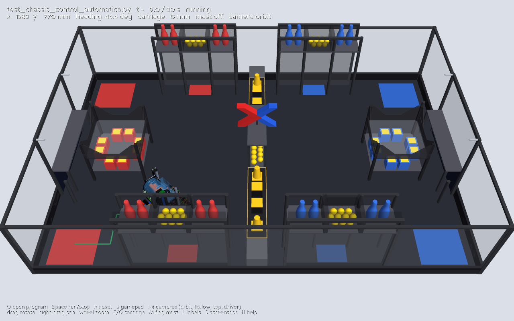

## Run

**Windows:** double-click `run_simulator_3d.bat`. **macOS:** double-click
`run_simulator_3d.command` (right-click > Open the first time if macOS blocks it).
The first run uses the same `.venv` as the 2D simulator and installs panda3d and
trimesh (and pygame if it is missing), then shows a menu: empty simulator,
automatic chassis demo or manual chassis demo.

**Manual setup:**

```bash
python3 -m venv .venv
.venv/bin/pip install -r simulation/field2d/requirements.txt -r simulation/field3d/requirements.txt
cd simulation/field3d
../../.venv/bin/python viewer3d.py
../../.venv/bin/python viewer3d.py --program ../control/test_chassis_control_automatico.py --camera follow
../../.venv/bin/python viewer3d.py --mast --carriage 358          # after the Modification Stage
../../.venv/bin/python viewer3d.py --screenshot shot.png --run-for 5 --program ...   # headless
../../.venv/bin/python -m unittest                                # checks
```

| Key / mouse | Action |
| --- | --- |
| `O` | Open an mBlock program (file picker in `simulation/control/`) |
| `Space` | Run / stop the program; `R` stops, a second `R` puts the robot back on its start pose |
| `J` | Open the emulated gamepad window (manual programs) |
| `1` `2` `3` `4` | Cameras: orbit (field), follow (behind the robot), top (orthographic), driver (red side) |
| Drag / right-drag / wheel | Rotate / pan / zoom |
| `E` / `Q` | Elevator carriage up / down (0–358 mm); a program moves it through `DC3` |
| `T` / `G` | Intake head up / down (0–380 mm); a program moves it through `DC2` |
| `M` | Flag mast on/off (installed in the Modification Stage) |
| `L` | Field labels |
| `V` | Vectors on/off: wheel rim speed (orange) and hub velocity (cyan); at the centre of mass (yellow cross) velocity (white), inertial force −m·a (red), inertial torque −Izz·α (magenta, vertical) |
| `X` | X-ray: semi-transparent robot to watch the balls inside (`--xray` at start) |
| `S` | Screenshot (`field3d_screenshot.png`) |
| `--balls initial / released / none` | Balls of the rules' initial state (default), the own resource balls released on the floor (manual stage), or none |
| `H` / `Esc` | Help on/off / quit |

Run limits are the same as in 2D: 30 s by default (`--time-limit`, 0 = none), the run
stops when a footprint corner leaves the field, on a program error, or on Stop.

## What moves

| Group | Parts (from `robot_model.json`) | Driven by |
| --- | --- | --- |
| Robot pose | Whole model | Simulated pose (`Simulation.pose`) |
| 4 mecanum wheels | Tyre, rollers, hub, coupling per corner | Encoder angle of each drive motor port |
| Elevator carriage | `CAR_`, `GR_`, `FLAG_receptor` (the 18 parts that move 358 mm between the two v22 STEP files) | `DC3` power (150 mm/s at 100 %), `E`/`Q` keys, `--carriage` |
| Intake head | 16 `INT_UR_` parts on the `INT_UR` rails: arms, slides, nut, fingered roller, belts, pulleys, roller motor | `DC2` power (53 mm/s at 100 %, estimate), `T`/`G` keys |
| Rollers and gears | Intake head roller, lower roller, star roller, helical centring roller and their gears; tower elbow roller and gears; basket feed roller; shooter friction wheels (16 sets) | `DC1` intake, `DC4` tower, `DC5` feeder, `BL1` shooter (displayed speed capped at 900 °/s) |
| Flag mast | `FLAG_mastil`, `FLAG_cabeza`, `FLAG_pasador`, `FLAG_ligas`, reference flag | `M` key or `--mast` |
| Balls | The 70 balls with dynamics ([`ball_physics.py`](../field2d/ball_physics.py)): they roll, bounce, collide, get pushed by the robot, travel through the intake, tower and basket, and fly when shot | Intake `DC1`, tower `DC4`, feeder `DC5`, shooter `BL1` |

## Mechanisms

The mechanism motors follow the program's `power_expand_board` ports, with the kinematic
model of [`simulation/field2d/mechanisms.py`](../field2d/mechanisms.py) and the ports, speeds
and travels in `robot_config.json` "mechanisms". The CAD only has the intake in one position,
so the intake-head parts, its travel (≈ 380 mm from the 428 mm rails) and the roller axes are
inferred from the part geometry (`robot_model.json`); ports and some speeds are assumptions
until the wiring is fixed. The intake reaches ball centres 0–60 mm above its head lift: floor
balls with the head down, the central resource levels with the head raised.

Menu option 5, or `viewer3d.py --program ../control/test_mechanisms.py --camera follow`, runs
[`test_mechanisms.py`](../control/test_mechanisms.py): rollers on, intake head up, tower,
feeder and shooter on, carriage to the top and back down.

| Intake head down (0.5 s) | Intake head 212 mm up, carriage at the top (7.5 s) |
| --- | --- |
| 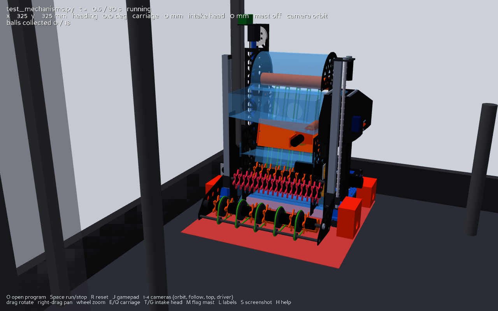 | 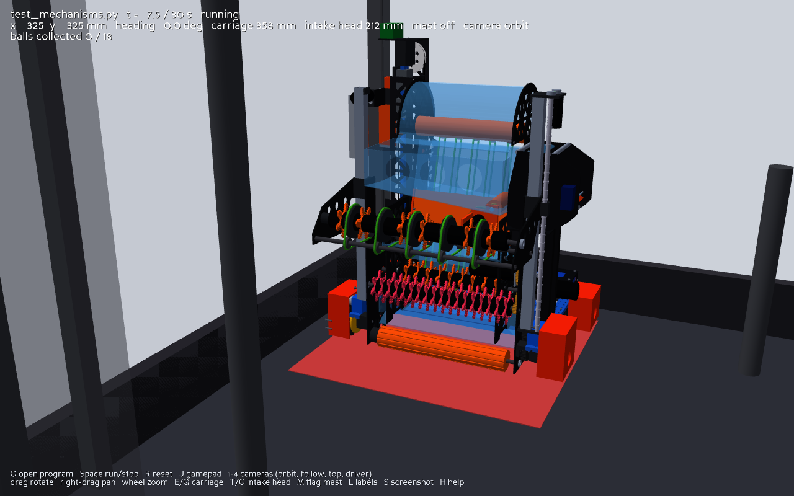 |

## Match clock and rule monitors

The top-right corner shows the stage and the time left (automatic 30 s, manual 100 s,
modification 60 s, final 90 s; [`match.py`](../field2d/match.py)), red in the last 5 s. Below it,
the rule monitors: **R19** (robot stationary at the end of the automatic stage, chassis and
slides checked) and **R06** (robot body outside the alliance area, 3 s grace; the intake head
overhang is allowed by team decision). Menu option 8 runs the automatic routine
[`auto_central_then_cubes.py`](../../software/autonomous/task_execution/auto_central_then_cubes.py),
analysed in [autonomous strategy](../../docs/07_strategy/autonomous_strategy.md).

Props are simulation objects ([`props.py`](../field2d/props.py)): bonus cubes, cones and letter cubes.
The gripper (`DC6` jaw, the moving jaw slides in 3D) takes a prop when the jaws close on it at the
grab point, which rides on the carriage, and drops it onto the support below when they open. The HUD
previews the automatic-stage result: valid bonus cubes (p.30 rules a–e) and the balls they add, cones
hung, letter cubes in channels.

| X12 in the gripper (24 s) | End of the automatic stage: X12 valid, robot stationary |
| --- | --- |
| 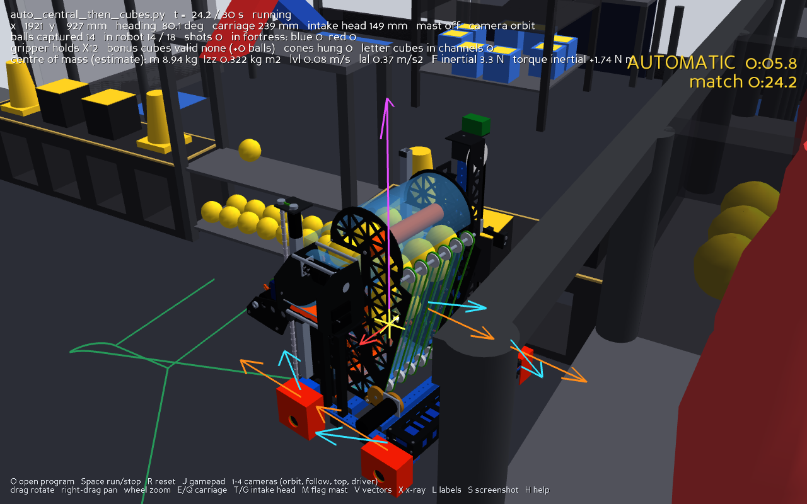 | 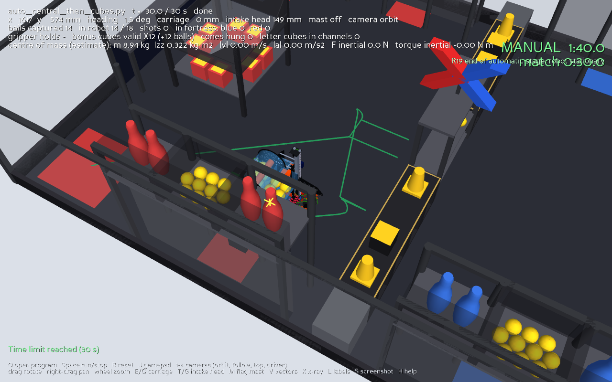 |

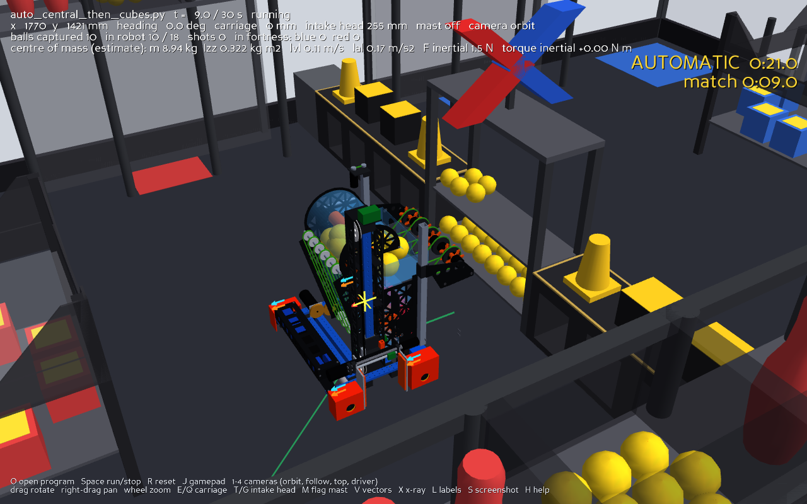

## Whole ball system and vectors

Menu option 7, or `viewer3d.py --balls released --program ../control/test_full_intake.py --time-limit 100 --xray`,
runs [`test_full_intake.py`](../control/test_full_intake.py): the robot collects the 10 balls of
red resource area 1 with the intake and tower running (they climb the tower and fill the basket),
drives to a shooting spot, turns its launcher (left side) toward the blue fortress, computes the
shooter power for a ballistic shot (2251 mm → 60 %) and fires until it is empty. In simulation the
10 shots land on the blue fortress ball level (≥ 8 required by the test).

| Balls climbing through the robot (x-ray, 6 s) | A shot on its way to the blue fortress (14 s) |
| --- | --- |
| 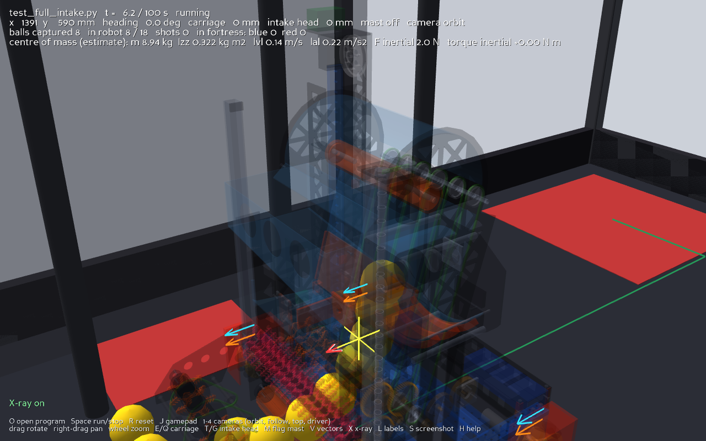 | 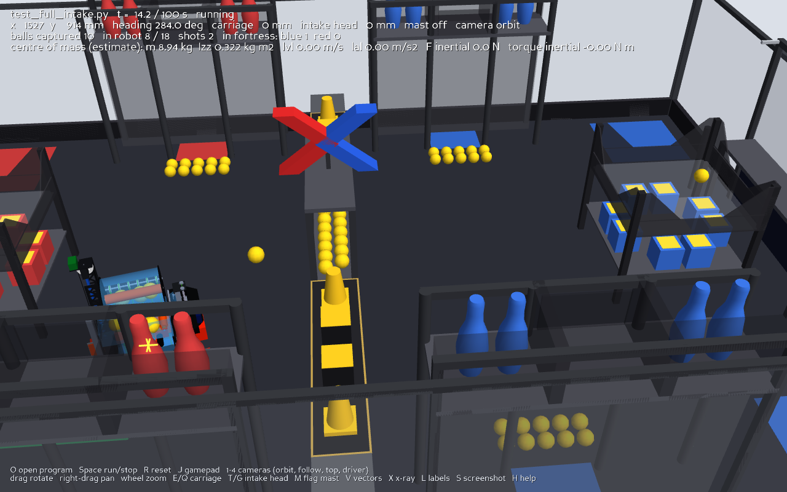 |

Ball path inside the robot (`robot_config.json` "ball_path"): 18 storage slots from the v22 CAD
reference balls (6 basket, 12 tower); waypoints through the head, the high-shelf chute, the tower,
the elbow and the basket; the feeder takes the first basket ball to the friction wheels, which launch
it at 8 m/s × power (40° hood, estimates). Each stretch moves only while its motor port has power.

Mass properties for the vectors come from [`robot_mass.json`](robot_mass.json), an **estimate** made by
[`tools/scripts/mass_properties.py`](../../tools/scripts/mass_properties.py) from mesh volumes,
material densities by part name and catalogue motor / electronics masses: **8.94 kg**, centre of mass
182 mm above the floor, Izz 0.322 kg·m². The centre of mass moves up with the carriage.

## Intake on the central resource shelf

Menu option 6, or `viewer3d.py --program ../control/test_intake_shelf.py --camera follow --time-limit 60`,
runs [`test_intake_shelf.py`](../control/test_intake_shelf.py): the robot raises the intake head
~254 mm (above the upper level's plate) and drives the head into the table, which works because
the head sticks out 134 mm ahead of the rest of the robot; the body stops at the table edge
(robot centre x ≤ 2105 mm). Two passes keep the 398 mm head between the table legs.

| Simulated result | Value |
| --- | --- |
| Upper level (ball centres 285 mm) | 15 / 15 collected, 10 + 5 per pass, by t = 26 s |
| Lower level | untouched (0 / 15); the same route with the head at ~53 mm takes 15 / 15 |
| Closest approach | robot centre x = 2100 mm (limit 2105) |
| Whole program | 34 s including 1 s calibration and lowering the head, longer than the 30 s automatic stage |

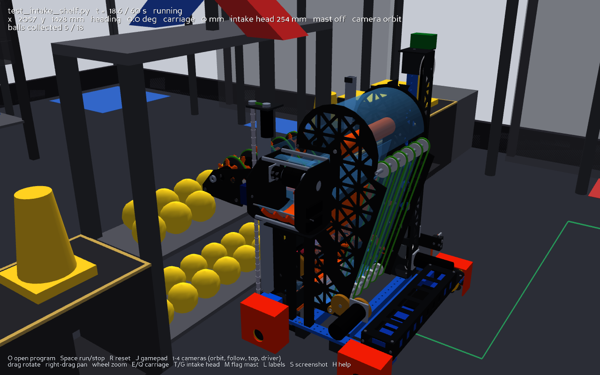

## Ball collection demo

Menu option 4 of the launcher, or
`viewer3d.py --balls released --program ../control/test_ball_collection.py --time-limit 100`:
the robot sweeps the balls released from both red own resource areas and fills its 18-ball
intake in about 19 s.

| After pass 1 (9 s) | End (19 s) |
| --- | --- |
| 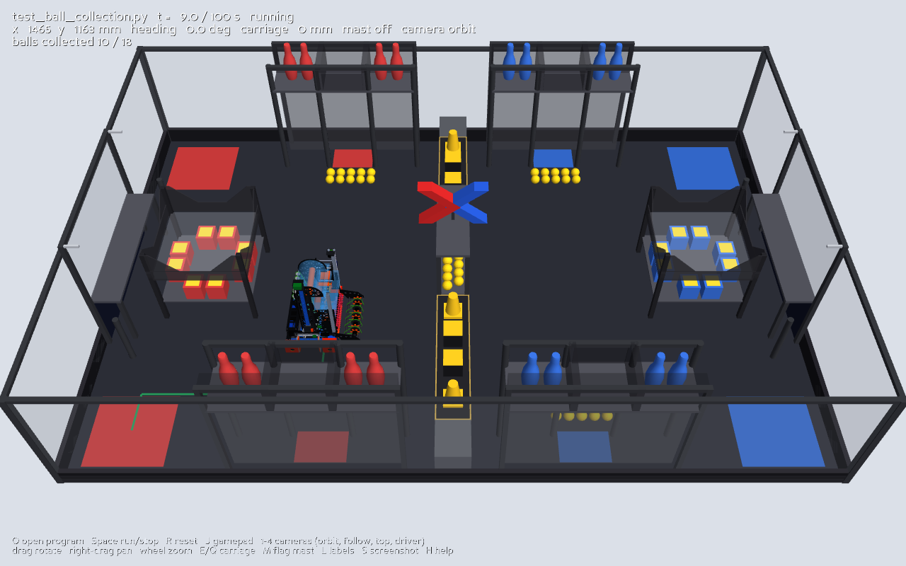 | 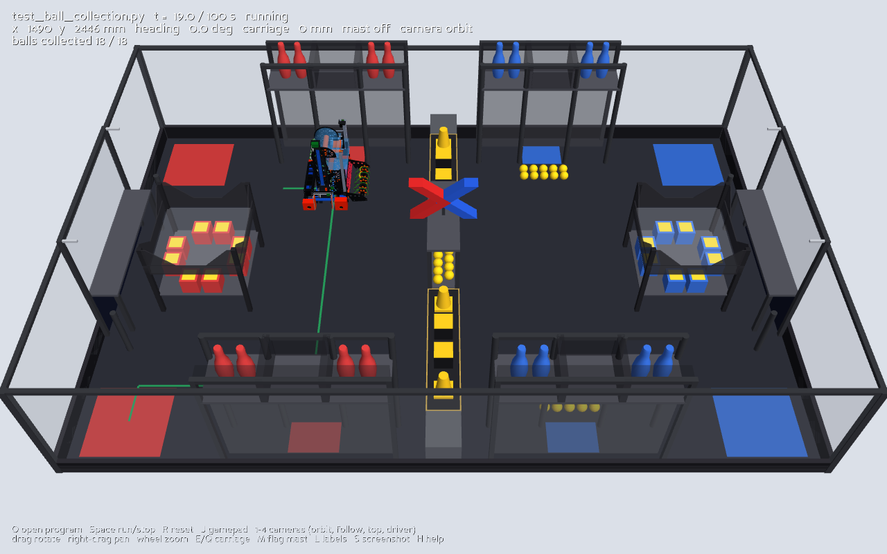 |

## Field details (from the rules)

The field uses the footprints and heights of `simulation/field2d/field_layout.py`
(placements are estimates recorded there) and builds each structure with the shape
given in the [rules guide](../../resources/rules/) V1.1, section 4.2–4.3
(`field_model.py` cites the page of every dimension):

| Structure | Detail in 3D | Rules |
| --- | --- | --- |
| Own resource area (×4) | Posts to 965 mm, side shelves at 758.5 mm with 2 pins each, central ball box (373 / 293 mm) with 10 balls, mesh below | p.13, Fig 4.2-6, 4.4-5 |
| Pin placement area (×2) | 985 × 195 mm shelf at 405 mm, MAKEX board below, posts to 965 mm with the flag poles at 961 mm | p.14–16, Fig 4.2-9/11 |
| Cone hanging posts (×4) | 40 mm posts, 405 mm high | p.17 |
| Strategy area (×2) | 960 × 215 × 259 mm frame, 52.5 mm top rail, four 140 mm channel windows with 80 mm dividers, gold trim | p.17–18, Fig 4.2-14 |
| Central resource area | Table top at 654 mm, two ball levels 200 mm apart with 15 balls each, X mark (red / blue chevrons) from 654 to 947 mm | p.19–21, Fig 4.2-17 |
| Mobile fortress (×2) | 640 × 640 × 646 mm, letter-cube level at 171 mm with 8 cubes, ball level at 407 mm, walls with the V cut-out | p.21–23, Fig 4.2-19 |
| Props | Pins 290 mm (70 / 100 mm), balls 70 mm, letter and bonus cubes 120 mm, cones 170 mm (120 mm base, 100→60 mm body) standing on the strategy area | p.23–26 |
| Frame | 900 mm high, semi-transparent, black floor as on the printed map | p.10 |

Plate thicknesses, post sections, the bottom rail of the strategy channel, the ball
level heights and the fortress cut-out are read off the figures (marked "estimate"
in the code). The prop layout is the default of `field_layout.py`; the real one comes
from the prop card drawn before each match.

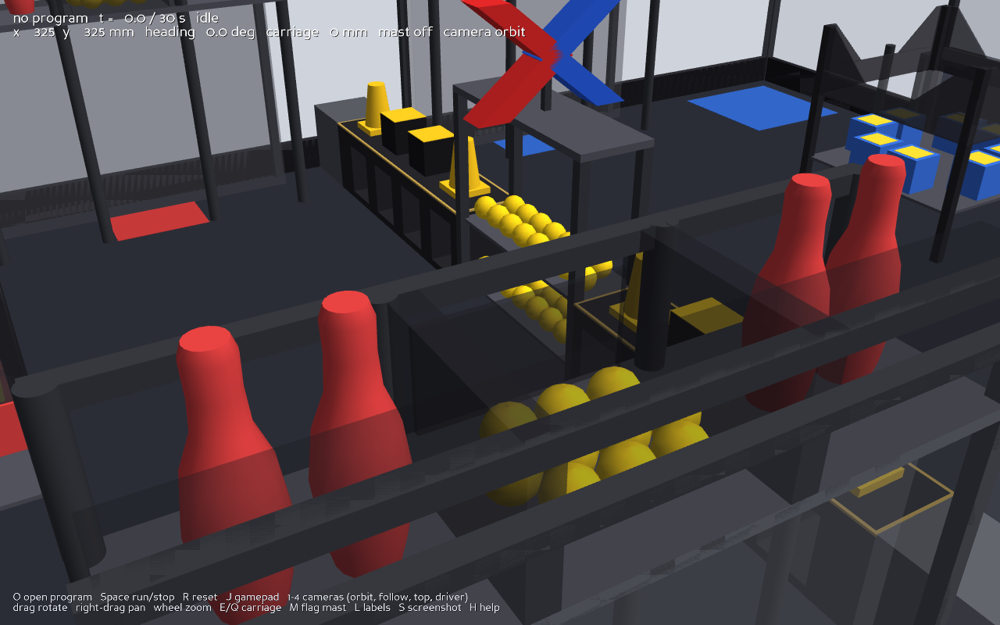

## Robot model pipeline

1. CAD: `mechanical/assemblies/full_robot/v22/cad/*.step.zip`.
2. Convert with [`tools/scripts/step_to_glb.py`](../../tools/scripts/step_to_glb.py)
   (Open CASCADE through `cascadio`, 0.5 mm tolerance) into
   [`assets/storm_breaker_v22.glb`](assets/storm_breaker_v22.glb): 235 named parts,
   246 k triangles, 8.7 MB, metres, CAD axes (+y forward, +x right, +z up).
3. [`robot_model.json`](robot_model.json) lists the wheel, carriage and mast parts.
   A new CAD revision needs a new GLB and, only if part names change, an edited JSON;
   `test_field3d.py` checks the groups against the CAD.

```bash
pip install -r tools/scripts/requirements-cad.txt
python tools/scripts/step_to_glb.py mechanical/assemblies/full_robot/v22/cad/Robot_StormBreaker_v22_con_mastil_y_bandera_carro_arriba.step.zip simulation/field3d/assets/storm_breaker_v22.glb
```

The 2D simulator uses the same drive geometry: `simulation/field2d/robot_config.json`
holds the v22 footprint (499.0 × 499.5 mm) and the measured wheel centres
(wheel rectangle 79 mm behind the footprint centre).

## State stream (Unreal Engine, ROS 2, other tools)

While running, the viewer sends the robot state as JSON over UDP to `127.0.0.1:5005`,
30 times per second (`--stream HOST:PORT`, `--stream-rate`, `--no-stream`). The schema
is documented in [`state_stream.py`](state_stream.py):

```json
{"v": 1, "robot": "storm_breaker_v22", "t": 12.34, "status": "running",
 "pose": {"x_mm": 1234.5, "y_mm": 567.8, "theta_deg": 90.0},
 "velocity": {"vx_mm_s": 0.0, "vy_mm_s": 0.0, "omega_deg_s": 0.0},
 "wheels": {"front_left": {"rpm": 0.0, "angle_deg": 0.0}, "...": {}},
 "carriage_mm": 0.0, "mast": false, "balls_collected": 0, "intake_lift_mm": 0.0}
```

`python stream_listener.py` prints the messages and is the starting point for a bridge:

- **Unreal Engine:** import `assets/storm_breaker_v22.glb` (Unreal's glTF importer), receive
  the UDP JSON in a Blueprint or C++ actor, and set the actor transform from `pose`
  (heading `theta_deg - 90`, because the CAD forward axis is +y) and the wheel rotations
  from `wheels`.
- **ROS 2:** a small node that receives the same JSON and publishes `pose` as a TF / odometry
  message and `wheels` as `sensor_msgs/JointState`, so RViz can show it. ROS 2 runs best on
  Ubuntu; this simulator keeps running on Windows and macOS.

The stream is one-way (simulator → tools); nothing outside can drive the simulation yet.

## Checks

`python -m unittest` in this directory (22 tests): wheel, carriage and mast groups match
the CAD; the model stands on the floor with the 499.5 × 499.0 mm footprint; wheel pivots at
the measured axles; the CAD forward axis follows the simulated heading; every field element
is built at its height and the rules details are present (16 pins, 20 + 30 balls, 16 letter cubes, shelf at 758.5 mm, 290 mm pins); stream messages round-trip and respect the rate; and an offscreen
render of the automatic demo (skipped when no graphics context is available).

## Limits

- The robot does not collide with the field structures (only the balls do); the simulation checks
  the field boundary, as in 2D. Robot tipping and the fortress moving are not modelled.
- Ball physics: point-mass spheres without spin, boxes for the structures, estimated coefficients;
  balls inside the robot follow waypoints and do not collide with each other.
- Mechanisms are kinematic (no load, no inertia); the gripper jaw, the shooter hood servo and
  ball flow through the tower and shooter are not simulated.
- Field element placements carry the estimates noted in `field_layout.py`.
